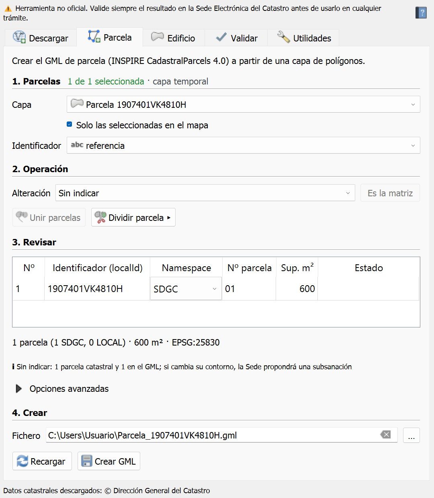
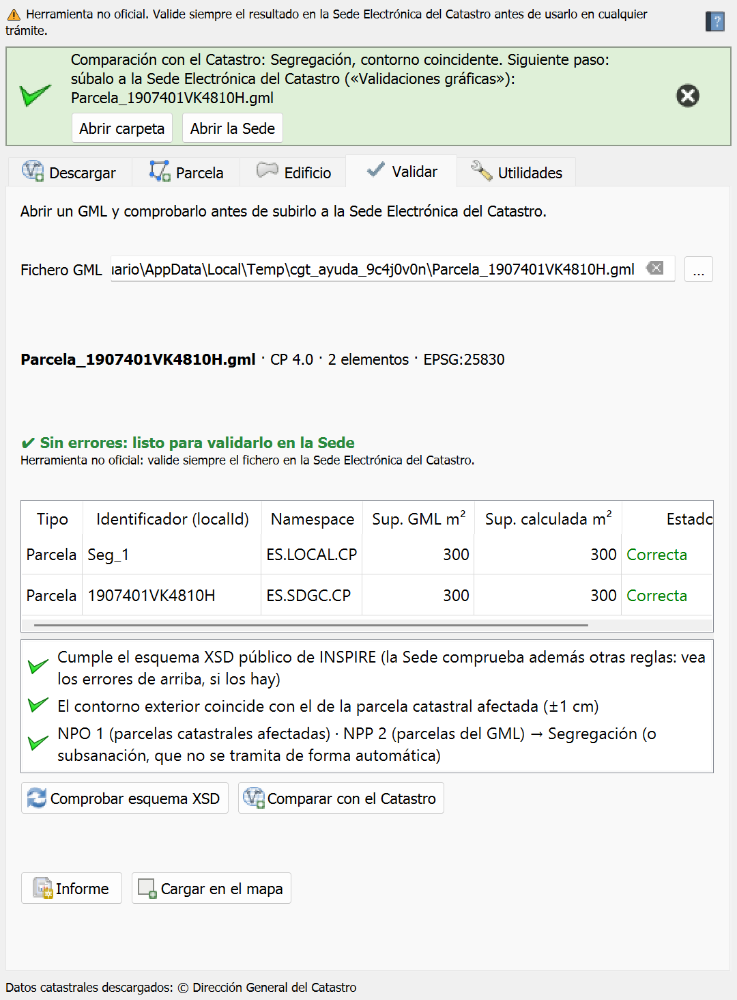

# Catastral GML Tools

[Español](#español) · [English](#english)

> ⚠ **Herramienta no oficial.** Catastral GML Tools no pertenece ni está avalada por la Dirección General del Catastro. Valide siempre el resultado en la [Sede Electrónica del Catastro](https://www.sedecatastro.gob.es/) antes de usarlo en cualquier trámite.

## Español

Plugin de QGIS para preparar los ficheros GML que pide la Sede Electrónica del Catastro:

- **GML de parcela** (INSPIRE CadastralParcels 4.0) para el informe de validación gráfica: una o varias parcelas, con un asistente que propone los identificadores de cada alteración (segregación, división, agregación, agrupación, subsanación, reparcelación).
- **GML de edificio** (INSPIRE BuildingExtended2D) para el informe de ubicación de las construcciones (ICUC): edificios y piscinas, con plantas y estado.
- **Descargar** una parcela concreta, sus colindantes y sus construcciones por referencia catastral (o con un clic en el mapa), de los servicios públicos de la Dirección General del Catastro.
- **Validar** un GML antes de subirlo, como la Sede: estructura, esquema XSD, identificadores, anillos, superficies, solapes y huecos, sistema de referencia y huso.
- **Comparar con el Catastro**: parcelas afectadas (NPO/NPP), operación, contorno exterior con ±1 cm, suelo sin parcela, dominio público, edificios dentro de su parcela.
- **Unir** parcelas seleccionadas y varios GML en uno (multiparcela), e **informe** HTML de la comprobación.
- **Dividir** una parcela (partes iguales, porcentajes, superficies, cuotas o franjas), **convertir** un GML del esquema 3.0 al 4.0 o repararlo, **informe de superficies y coordenadas** (linderos, superficies, vértices y lados) y **ajuste a la cartografía catastral desplazada o girada** (parámetros de transformación de la Sede y GML ajustado) y **comparar dos GML** (desplazamiento de vértices, superficies, redondeo; iguales a efectos de la Sede).

- **Panel por pasos** (Parcela y Edificio: 1 capa → 2 operación → 3 revisar → 4 crear), con la ayuda integrada: flujo de trabajo de la referencia catastral a la Sede y capturas reales.

 

> Estado: **versión 1.0.0** (estable). Ver [CHANGELOG](CHANGELOG.md) y [docs/DESARROLLO.md](docs/DESARROLLO.md).

### Requisitos
QGIS 3.34 o posterior, incluido QGIS 4 (Qt6). Sin dependencias externas.

### Instalación
- Desde el repositorio oficial de QGIS: *Complementos → Administrar e instalar complementos* → buscar «Catastral GML Tools».
- Desde ZIP: descarga el ZIP de la última [versión](https://github.com/FGomezLosada/CatastralGMLTools/releases) y usa *Complementos → Instalar a partir de ZIP*.

El panel se abre desde el botón de la barra de herramientas o desde *Vectorial → Catastral GML Tools*.

### Ámbito territorial
Territorio gestionado por la Dirección General del Catastro. Navarra y los territorios forales del País Vasco (Álava/Araba, Gipuzkoa y Bizkaia) tienen catastros propios: el plugin los detecta y lo indica, y descarga sus parcelas de sus servicios INSPIRE solo para verlas (el GML de la Sede de la DGC no sirve allí).

### Datos
Los datos descargados proceden de los servicios públicos de la **Dirección General del Catastro**, que se cita como fuente junto con la fecha de descarga. El plugin no usa datos protegidos (titulares ni valores catastrales) y no incluye datos del Catastro.

### Licencia
GPL-2.0-or-later. Ver [LICENSE](LICENSE) y [CREDITS.md](CREDITS.md).

---

## English

QGIS plugin to prepare the GML files required by the Spanish Cadastre electronic office (Sede Electrónica del Catastro):

- **Cadastral parcel GML** (INSPIRE CadastralParcels 4.0) for graphic validation reports, with an assistant for the identifiers of each kind of change.
- **Building GML** (INSPIRE BuildingExtended2D) for construction location reports (ICUC).
- **Download** a single parcel, its neighbours and its buildings by cadastral reference.
- **Check** a GML before uploading it and **compare** it with the current cadastral parcels (operation, ±1 cm boundary).
- **Split** a parcel and **convert** a parcel GML from schema 3.0 to 4.0 (or repair a 4.0 one).
- **Merge** selected parcels and several GML files, and save an HTML check report.

> Status: **version 1.0.0** (stable).

Requires QGIS 3.34 or later, including QGIS 4 (Qt6). Covers the territory managed by the Spanish Directorate General for Cadastre; Navarre and the Basque Country have their own cadastres. **Not an official tool**: always validate the result in the Sede Electrónica del Catastro. Cadastral data: Dirección General del Catastro. User interface in Spanish. Licence: GPL-2.0-or-later.

---

© 2026 Francisco Gómez Losada
